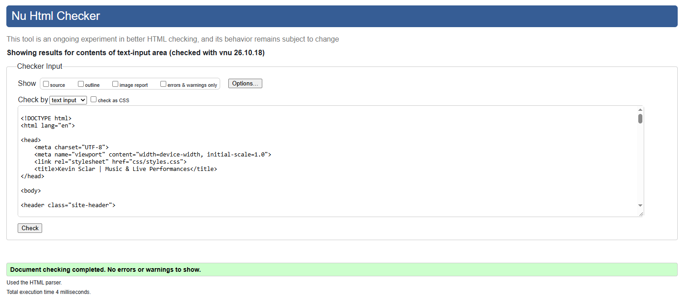

Kevin Sclar - Music EPK Website

For my capstone project, I created a responsive, multi-page Electronic Press Kit (EPK) website to showcase my work as a musician. The website is designed to give venues, event organizers, and other musicians a place to learn about me, watch my performances, and contact me about potential opportunities.

The website consists of six pages: Home, About, Performances, Gallery, Services, and Contact. These pages include my musical background, performance videos, photos, services, and a contact form for booking inquiries and collaborations.

I used semantic HTML to organize each page and a shared external CSS stylesheet to maintain a consistent design. My color palette uses dark blue-grey backgrounds (#18222c, #263746, and #354b5c), light text (#f5f5f5), and a light blue accent (#9fc5df). I used Arial as my primary font.

I used Flexbox and CSS Grid to organize the layout, along with media queries to make the website responsive. At 600px, certain layouts expand for larger screens, while at 769px, the About page changes from a single-column layout to a two-column layout.

The website also includes two JavaScript files: one for the interactive gallery and another for automatically formatting phone numbers on the Contact page.

I included descriptive alt text, semantic HTML, keyboard-accessible navigation, and highlighted the active page in the navigation menu to help visitors know where they are on the website. I tested the website at different screen sizes and used the W3C Nu HTML Checker to validate my HTML.

Future Improvements

For Milestone 3, I plan to publish the website, make the contact form fully functional, and continue improving its aesthetics and accessibility. Also, my footer needs to actually link to my socials, that's important!

